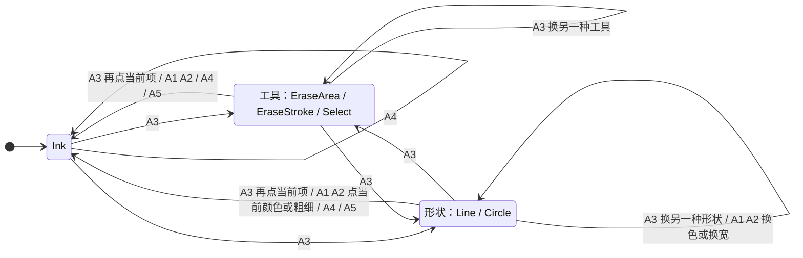

# 工具栏工具态

范围：主工具栏全部工具控件、选区工具条的克隆、`Esc` / `Delete` / `Ctrl+X` / 翻页入口。左工具栏、右工具栏、背景单选不改变工具态，见 §8。

## 1. 状态量

| ID | 名称 | 取值域 | 初值 | 位置 |
| --- | --- | --- | --- | --- |
| S1 | `Mode` | `Ink`、`Line`、`Circle`、`EraseArea`、`EraseStroke`、`Select` | `Ink` | `MainWindow.Toolbar.cs` |
| S2 | `HighlighterActive` | `true`、`false` | `false` | 同上 |
| S3 | `stamp` | `None`、`Clone`、`Paste` | `None` | 同上 |
| S4 | `pen` | 颜色、宽度 | `#E6E6E6`、3 DIP | 同上 |
| S5 | `colorRadio`、`thicknessRadio` | 颜色、粗细单选 | `DefaultColorRadio`、`DefaultThicknessRadio` | 同上 |

`pen` 的其余属性固定为 `IsHighlighter=false`、`StylusTip=Ellipse`、`IgnorePressure=false`。`HighlighterProfile` 固定为黄、36 DIP、`IsHighlighter=true`、`Ellipse`、`IgnorePressure=true`。曲线拟合由设置项与画布选项 `FitToCurve` 决定，工具预设不写。

`SyncToolState` 把状态量写入画布：

| ID | 目标 | 值 |
| --- | --- | --- |
| D1 | `CanvasNext.Mode` | `Mode` |
| D2 | `CanvasNext.StampAction` | `stamp` |
| D3 | `CanvasNext.DefaultDrawingAttributes` | `HighlighterActive ? HighlighterProfile : pen` |

写入顺序为 D2 → D1 → D3：`OnModeChanged` 会读当前 `StampAction`。

## 2. 不变式

| ID | 条件 |
| --- | --- |
| I1 | `HighlighterActive` ⇒ `Mode = Ink` |
| I2 | `SyncToolState` 之后 `stamp ≠ None` ⇒ `Mode ∈ { Ink, Select }` |
| I3 | 每次 `SyncToolState` 之后 D1–D3 等于 S1–S4 |
| I4 | 勾选态只由 `SyncToolState` 写入，满足 §6 的公式 |

## 3. 状态图

`A4` 在两个方向都把 `Mode` 写为 `Ink`，开关值取自 `HighlighterToggle.IsChecked`。

## 4. 动作

| ID | 触发 | 前置 | 状态写入 |
| --- | --- | --- | --- |
| A1 | 颜色单选 `Click` | 发送者 `Background` 是 `SolidColorBrush`，否则不处理 | 按 §5 |
| A2 | 粗细单选 `Click` | 发送者 `MinWidth` 可读，否则不处理 | 按 §5 |
| A3 | 模式单选 `Click` | 发送者 `RadioButton` | `stamp=None`；`prev=Mode`；`HighlighterActive=false`；`Mode = prev==X ? Ink : X` |
| A4 | 荧光笔 `ToggleButton` `Click` | — | `stamp=None`；`HighlighterActive=IsChecked`；`Mode=Ink` |
| A5 | 粘贴 `ToggleButton` `Click` | 勾选时剪贴板含 `InkSerializedFormat` | 勾选且前置成立：`HighlighterActive=false`、`Mode=Ink`、`stamp=Paste`；勾选但前置不成立：不改印章；取消勾选且 `stamp=Paste`：`stamp=None` |
| A6 | 克隆 `ToggleButton` `Click` | 勾选时 `CanvasNext.HasSelection` | 勾选且前置成立：`stamp=Clone`；勾选但前置不成立：不改印章；取消勾选且 `stamp=Clone`：`stamp=None` |
| A7 | 清屏 `Click` | — | `stamp=None`，随后清空当前页墨迹 |

A3 的 `X` 由控件的 `Tag` 映射：

| `Tag` | 模式 | 控件 |
| --- | --- | --- |
| `E73C` | `Line` | 直线 |
| `EA3A` | `Circle` | 圆 |
| `ED60` | `EraseArea` | 面积擦除 |
| `ED61` | `EraseStroke` | 笔迹擦除，单选为 `Collapsed`，无可见入口 |
| `EF20` | `Select` | 选择 |
| 其他 | `Ink` | 无对应控件 |

## 5. 颜色与粗细的效果

| 条件 | `Mode` | `HighlighterActive` | `stamp` | `pen` |
| --- | --- | --- | --- | --- |
| 形状模式 ∧ 点击项等于当前颜色或粗细 | `Ink` | `false` | `None` | 不变 |
| 形状模式 ∧ 点击项不等于当前项 | 不变 | `false` | `None` | 换色或换宽 |
| 工具模式 | `Ink` | `false` | `None` | 换色或换宽 |
| `Ink` | `Ink` | `false` | `None` | 换色或换宽 |

形状模式与 `HighlighterActive=true` 不可能同时成立（I1），第一行不写开关。

## 6. 勾选态

`IsToolMode(Mode)` ⇔ `Mode ∈ { EraseArea, EraseStroke, Select }`。

| 控件 | 勾选 ⇔ |
| --- | --- |
| 颜色、粗细 | `¬HighlighterActive ∧ ¬IsToolMode(Mode) ∧ stamp=None` |
| 直线 | `Mode=Line` |
| 圆 | `Mode=Circle` |
| 面积擦除 | `Mode=EraseArea` |
| 笔迹擦除 | `Mode=EraseStroke` |
| 选择 | `Mode=Select` |
| 荧光笔 | `HighlighterActive` |
| 克隆 | `stamp=Clone` |
| 粘贴 | `stamp=Paste` |

控件只监听 `Click`；程序写 `IsChecked` 不会再次进入处理程序。

## 7. 模式点击矩阵（A3）

行为当前模式，列为点击的模式，单元格为写入后的 `Mode`。每格同时写 `stamp=None`、`HighlighterActive=false`。

| 当前 ＼ 点击 | 直线 | 圆 | 面积擦除 | 笔迹擦除 | 选择 |
| --- | --- | --- | --- | --- | --- |
| `Ink` | `Line` | `Circle` | `EraseArea` | `EraseStroke` | `Select` |
| `Line` | `Ink` | `Circle` | `EraseArea` | `EraseStroke` | `Select` |
| `Circle` | `Line` | `Ink` | `EraseArea` | `EraseStroke` | `Select` |
| `EraseArea` | `Line` | `Circle` | `Ink` | `EraseStroke` | `Select` |
| `EraseStroke` | `Line` | `Circle` | `EraseArea` | `Ink` | `Select` |
| `Select` | `Line` | `Circle` | `EraseArea` | `EraseStroke` | `Ink` |

## 8. 清理与不改变状态的入口

`SyncToolState` 开头执行 N1；其余入口按行写入。

| ID | 入口 | 结果 |
| --- | --- | --- |
| N1 | `SyncToolState` | `Mode ∉ { Ink, Select }` 时 `stamp=None` |
| A8 | `Esc` | `stamp=None`；取消进行中的手势 |
| A9 | `Delete`、`Ctrl+X` | 命令可执行（有选区且非只读）时先 `stamp=None` |
| A10 | 翻页 | `stamp=None`；隐藏选区工具条；重置触点 |
| A11 | 窗口失活 | 只重置触点 |

不改变 S1–S5 的控件：

| 区域 | 控件 |
| --- | --- |
| 左工具栏 | 关闭、最小化、文件菜单、背景、切换窗口 |
| 右工具栏 | 收起与展开、菜单、上一页、页码、下一页 |
| 主工具栏 | 展开开关（只改高度）、撤销、重做 |
| 背景单选 | 默认、纯白、纯黑、透明、视频 |

选区工具条按动作分派：复制不改变工具态，剪切与删除按 A9，克隆按 A6。

## 9. 规则与代码对照

| 规则 | 代码 |
| --- | --- |
| S1–S5、D1–D3、I1–I4、N1、勾选态 | `LightBoard/MainWindow.Toolbar.cs`：字段与 `SyncToolState` |
| A1 | `LightBoard/MainWindow.Handler.cs`：`ColorRadioChecked` |
| A2 | 同上：`ThicknessRadioClick` |
| A3、Tag 映射 | 同上：`ModeRadioChecked` |
| A4 | `LightBoard/MainWindow.Toolbar.cs`：`HighlighterBoxClicked` |
| A5 | `LightBoard/MainWindow.Handler.cs`：`PasteClick` |
| A6 | 同上：`CloneClick` |
| A7 | 同上：`EraseAll` |
| A8 | `LightBoard/MainWindow.xaml.cs`：`MainWindowKeyUp`；`LightBoard/InkCanvasNext/Commands.cs`：`CancelExecuted` |
| A9 | `LightBoard/MainWindow.Commands.cs`：`MainWindowPreviewExecuted` |
| A10 | `LightBoard/MainWindow.Pages.cs`：`OnPageChanged` |
| A11 | `LightBoard/MainWindow.xaml.cs`：`WindowDeactivated` |

## 10. 核对顺序

1. §1 的初值与字段声明逐项对照
2. §2 的不变式逐条对照 `SyncToolState` 与 A1–A6 的写入
3. §6 的勾选公式逐行对照 `SyncToolState` 的控件赋值
4. §7 的矩阵逐格对照 A3 的 `Mode = prev == X ? Ink : X`
5. §8 的入口逐行对照调用点
