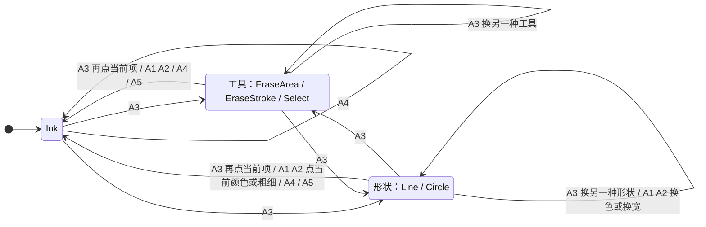

# 工具栏工具态

范围：主工具栏全部工具控件、选区工具条的克隆、`Esc` / `Delete` / `Ctrl+X` / 翻页入口。左工具栏、右工具栏、背景单选不改变工具态，见 §8。

## 1. 工具状态

工具态只有一个值 `DrawingAttributesNext`，由画布保存：

| 字段 | 取值 | 初值 |
| --- | --- | --- |
| `Mode` | `Ink`、`Line`、`Circle`、`EraseArea`、`EraseStroke`、`Select` | `Ink` |
| `Stamp` | `None`、`Clone`、`Paste` | `None` |
| `DrawingAttributes` | 颜色、宽高、笔尖、`FitToCurve`、`IgnorePressure`、`IsHighlighter` | `#E6E6E6`、3、椭圆 |

画布只暴露可读写依赖属性 `DrawingAttributes`；所有写入直接赋值 `DrawingAttributes = DrawingAttributes with { ... }`。切模式并清印章要显式写这两个字段。`DrawingAttributes` 子项在写入与读取时都克隆。依赖属性的 Coerce 归一化非法组合：

| 条件 | 结果 |
| --- | --- |
| `Mode` 或 `Stamp` 枚举值未定义 | 分别取 `Ink`、`None` |
| `Mode ∉ { Ink, Select }` | `Stamp = None` |

宿主保存普通笔预设 `pen`、颜色单选 `colorRadio` 与粗细单选 `thicknessRadio`。高亮预设由 `pen` 派生：

```csharp
private static DrawingAttributes CreateHighlighter(DrawingAttributes source)
{
    var attributes = source.Clone( );
    attributes.Color = Colors.Yellow;
    attributes.Width = attributes.Height = 36;
    attributes.StylusTip = StylusTip.Ellipse;
    attributes.IgnorePressure = true;
    attributes.IsHighlighter = true;
    return attributes;
}
```

## 2. 不变式

| ID | 条件 |
| --- | --- |
| I1 | `Stamp ≠ None` ⇒ `Mode ∈ { Ink, Select }` |
| I2 | 静止且非只读时，每次写 `DrawingAttributes` 之后画布编辑模式等于 `DrawingAttributes.Mode`，内层笔触属性等于 `DrawingAttributes.DrawingAttributes`；手势进行中编辑模式在迁出 `Idle` 时应用 |
| I3 | 勾选态与 `DrawingAttributes` 一致，满足 §6 的公式 |
| I4 | 前置条件不成立的点击不改 `DrawingAttributes`，由 `RefreshToolChecks` 写回勾选 |

高亮与模式互不约束：`IsHighlighter` 只是笔触属性，切高亮由 A4 同时写 `Mode = Ink`。

## 3. 状态图



`A4` 两个方向都把 `DrawingAttributes` 写为高亮预设或 `pen`，同时把 `Mode` 写为 `Ink`，开关值取自 `HighlighterToggle.IsChecked`。

## 4. 动作

| ID | 触发 | 前置 | 状态写入 |
| --- | --- | --- | --- |
| A1 | 颜色单选 `Click` | 发送者 `Background` 是 `SolidColorBrush`，否则不处理 | 按 §5 |
| A2 | 粗细单选 `Click` | 发送者 `MinWidth` 可读，否则不处理 | 按 §5 |
| A3 | 模式单选 `Click` | 发送者 `RadioButton` | `DrawingAttributes = DrawingAttributes with { Mode = prev == X ? Ink : X, Stamp = None, DrawingAttributes = pen }` |
| A4 | 荧光笔 `ToggleButton` `Click` | — | 勾选：`DrawingAttributes = DrawingAttributes with { DrawingAttributes = CreateHighlighter(pen), Mode = Ink, Stamp = None }`；取消：`DrawingAttributes = DrawingAttributes with { DrawingAttributes = pen, Mode = Ink, Stamp = None }` |
| A5 | 粘贴 `ToggleButton` `Click` | 勾选时剪贴板含 `InkSerializedFormat` | 勾选且前置成立：`DrawingAttributes = DrawingAttributes with { DrawingAttributes = pen, Stamp = Paste, Mode = Ink }`；勾选但前置不成立：不改状态，`RefreshToolChecks( )`；取消勾选且 `Stamp = Paste`：`DrawingAttributes = DrawingAttributes with { Stamp = None }` |
| A6 | 克隆 `ToggleButton` `Click` | 勾选时 `CanvasNext.HasSelection` | 勾选且前置成立：`DrawingAttributes = DrawingAttributes with { Stamp = Clone }`；勾选但前置不成立：不改状态，`RefreshToolChecks( )`；取消勾选且 `Stamp = Clone`：`DrawingAttributes = DrawingAttributes with { Stamp = None }` |
| A7 | 清屏 `Click` | — | `DrawingAttributes = DrawingAttributes with { Stamp = None }`，随后清空当前页墨迹 |

A3 的 `X` 由控件的 `Tag` 映射：

| `Tag` | 模式 | 控件 |
| --- | --- | --- |
| `E73C` | `Line` | 直线 |
| `EA3A` | `Circle` | 圆 |
| `ED60` | `EraseArea` | 面积擦除 |
| `ED61` | `EraseStroke` | 笔迹擦除，单选为 `Collapsed`，无可见入口 |
| `EF20` | `Select` | 选择 |
| 其他 | `Ink` | 无对应控件 |

## 5. 颜色与粗细的效果

颜色与粗细点击先写 `colorRadio` / `thicknessRadio`，再写 `DrawingAttributes`；`DrawingAttributesChanged` 处理程序据此刷新勾选。

| 条件 | `Mode` | `Stamp` | 笔触属性 |
| --- | --- | --- | --- |
| 形状模式 ∧ 点击项等于当前颜色或粗细 | `Ink` | `None` | `pen` |
| 形状模式 ∧ 点击项不等于当前项 | 不变 | `None` | `pen` 换色或换宽 |
| 工具模式 | `Ink` | `None` | `pen` 换色或换宽 |
| 印章激活 | `IsToolMode(Mode) ? Ink : Mode` | `None` | `pen` 换色或换宽 |
| `Ink` | `Ink` | `None` | `pen` 换色或换宽 |

高亮期间点颜色或粗细时，以 `pen` 为基准改写，不带上高亮的黄色、36 DIP 与忽略压感。

颜色与粗细单选由宿主点击记录；外部直接写 `DrawingAttributes.DrawingAttributes` 时单选不跟随，下一次工具写入会被覆盖。需要调整画笔时写 `DrawingAttributes`。

## 6. 勾选态

`IsToolMode(Mode)` ⇔ `Mode ∈ { EraseArea, EraseStroke, Select }`。

| 控件 | 勾选 ⇔ |
| --- | --- |
| 颜色、粗细 | `¬DrawingAttributes.IsHighlighter ∧ ¬IsToolMode(Mode) ∧ Stamp = None` |
| 直线 | `Mode = Line` |
| 圆 | `Mode = Circle` |
| 面积擦除 | `Mode = EraseArea` |
| 笔迹擦除 | `Mode = EraseStroke` |
| 选择 | `Mode = Select` |
| 荧光笔 | `DrawingAttributes.IsHighlighter` |
| 克隆 | `Stamp = Clone` |
| 粘贴 | `Stamp = Paste` |

`CanvasNextDrawingAttributesChanged` 依次调用 `RefreshToolChecks`、`TrackToolIdentity`、`UpdateRevertLabel`；构造期在默认颜色与粗细单选就位后显式调用三者一次。控件只监听 `Click`，程序写 `IsChecked` 不会再次进入处理程序。

## 7. 模式点击矩阵（A3）

行为当前模式，列为点击的模式，单元格为写入后的 `Mode`。每格同时清掉印章并把笔触属性写回 `pen`。

| 当前 ＼ 点击 | 直线 | 圆 | 面积擦除 | 笔迹擦除 | 选择 |
| --- | --- | --- | --- | --- | --- |
| `Ink` | `Line` | `Circle` | `EraseArea` | `EraseStroke` | `Select` |
| `Line` | `Ink` | `Circle` | `EraseArea` | `EraseStroke` | `Select` |
| `Circle` | `Line` | `Ink` | `EraseArea` | `EraseStroke` | `Select` |
| `EraseArea` | `Line` | `Circle` | `Ink` | `EraseStroke` | `Select` |
| `EraseStroke` | `Line` | `Circle` | `EraseArea` | `Ink` | `Select` |
| `Select` | `Line` | `Circle` | `EraseArea` | `EraseStroke` | `Ink` |

## 8. 清理与不改变状态的入口

| ID | 入口 | 结果 |
| --- | --- | --- |
| N1 | `DrawingAttributes` 的 Coerce | 非法组合按 §1 表改回合法值；同值写入返回当前值，不触发事件 |
| A8 | `Esc` | 窗口 `InputBindings` 把 `Cancel` 命令送到画布，`CancelExecuted` 先重置触点，再 `DrawingAttributes = DrawingAttributes with { Stamp = None }` |
| A9 | `Delete`、`Ctrl+X` | 命令可执行（有选区且非只读）时先 `DrawingAttributes = DrawingAttributes with { Stamp = None }` |
| A10 | 翻页 | `Strokes` 替换触发 `ApplyStrokes`，内部 `DrawingAttributes = DrawingAttributes with { Stamp = None }`；隐藏选区工具条；重置触点 |
| A11 | 窗口失活 | 只重置触点 |

不改变 `DrawingAttributes` 的控件：

| 区域 | 控件 |
| --- | --- |
| 左工具栏 | 关闭、最小化、文件菜单、背景、切换窗口 |
| 右工具栏 | 收起与展开、菜单、上一页、页码、下一页 |
| 主工具栏 | 展开开关（只改高度）、撤销、重做 |
| 背景单选 | 默认、纯白、纯黑、透明、视频 |

选区工具条按动作分派：复制不改变工具态，剪切与删除按 A9，克隆按 A6。

## 9. 规则与代码对照

| 规则 | 代码 |
| --- | --- |
| `DrawingAttributesNext`、`DrawingAttributes` 依赖属性、`CoerceDrawingAttributes`、`Normalize` | `LightBoard/InkCanvasNext/DrawingAttributesNext.cs` |
| 内层笔触属性的观察 | `LightBoard/InkCanvasNext/TaperInkCanvas.cs`：`ObserveDefaultDrawingAttributes` |
| 状态机的工具快照 | `LightBoard/InkCanvasNext/States.cs`：`Snapshot` |
| A1 | `LightBoard/MainWindow.Handler.cs`：`ColorRadioChecked` |
| A2 | 同上：`ThicknessRadioClick` |
| A3、Tag 映射 | 同上：`ModeRadioChecked` |
| A4 | `LightBoard/MainWindow.Toolbar.cs`：`HighlighterBoxClicked`、`CreateHighlighter` |
| A5 | `LightBoard/MainWindow.Handler.cs`：`PasteClick` |
| A6 | 同上：`CloneClick` |
| A7 | 同上：`EraseAll` |
| A8 | `LightBoard/InkCanvasNext/Commands.cs`：`CancelExecuted`；窗口绑定在 `LightBoard/MainWindow.Commands.cs` |
| A9 | `LightBoard/MainWindow.Commands.cs`：`MainWindowPreviewExecuted` |
| A10 | `LightBoard/InkCanvasNext/InkCanvasNext.xaml.cs`：`ApplyStrokes`；翻页在 `LightBoard/MainWindow.Pages.cs` |
| A11 | `LightBoard/MainWindow.xaml.cs`：`WindowDeactivated` |
| 勾选刷新 | `LightBoard/MainWindow.Toolbar.cs`：`CanvasNextDrawingAttributesChanged`、`RefreshToolChecks` |

## 10. 核对顺序

1. §1 的字段、初值与 `Normalize` 表逐项对照 `DrawingAttributesNext.cs`
2. §2 的不变式逐条对照 `DrawingAttributes` 的 Coerce 与 §4 的写入
3. §6 的勾选公式逐行对照 `RefreshToolChecks`
4. §7 的矩阵逐格对照 A3 的 `DrawingAttributes = DrawingAttributes with { Mode = prev == X ? Ink : X, Stamp = None, DrawingAttributes = pen }`
5. §8 的入口逐行对照调用点
6. 跑控制测试与宿主测试，重点看失败前置、翻页、`Esc` 与自动回退
